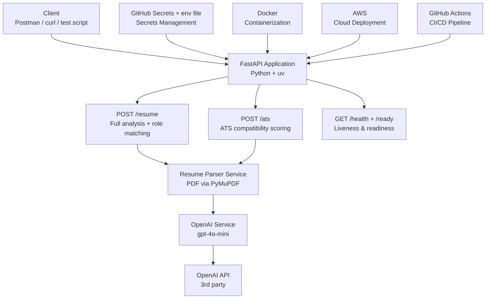
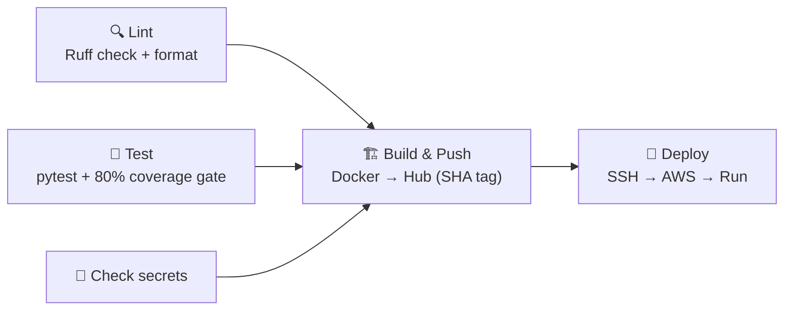

# 🎯 Resume Analyzer API
> AI-powered resume analysis and ATS scoring REST API built with FastAPI and OpenAI GPT-4o-mini.

[](https://github.com/akkabakovb/Resume_Scanner_SoftwareEngineering/actions/workflows/deploy.yml)


---

## 📋 Table of Contents

- [Project Overview](#-project-overview)
- [Live Demo](#-live-demo)
- [Architecture](#-architecture)
- [API Endpoints](#-api-endpoints)
- [Tech Stack](#-tech-stack)
- [CI/CD Pipeline](#-cicd-pipeline)
- [Secrets Management](#-secrets-management)
- [Getting Started](#-getting-started)
- [Running Tests](#-running-tests)
- [Docker](#-docker)
- [Team](#-team)

---

## 🚀 Project Overview

The Resume Analyzer API is a production-grade REST API that uses OpenAI's GPT-4o-mini to provide:

- **Resume Analysis** — Upload a PDF resume and receive an AI-powered analysis including an overall quality score, strengths, weaknesses, key skills, an improved professional summary, and career recommendations.
- **ATS Scoring** — Upload a PDF resume alongside a job description to receive an ATS compatibility score, matched and missing keywords, suggestions for improvement, and a verdict on whether the resume would pass automated screening.

Built as a capstone project for CS 3321 — Introduction to Software Engineering at Idaho State University, Spring 2026.

---

## 🌐 Live Demo

The API is deployed and running live on AWS EC2:

```
http://54.241.193.136/docs
```

Test the endpoints interactively using the Swagger UI at the link above.

---

## 🏗 Project Architecture



---

## 📡 API Endpoints

### `POST /resume`
Upload a PDF resume for a combined AI-powered analysis and job role matching.

**Request:** `multipart/form-data`
- `file` — PDF resume file

**Response:**
```json
{
  "score": 85,
  "strengths": ["Strong Python skills", "..."],
  "weaknesses": ["Lacks certifications", "..."],
  "skills": ["Python", "FastAPI", "Docker"],
  "improved_summary": "Results-driven developer...",
  "recommendation": "Apply for software engineering internships",
  "matched_roles": [
    {
      "title": "Machine Learning Engineer Intern",
      "reason": "Strong ML experience...",
      "match_score": 90,
      "key_skills": ["Python", "TensorFlow"]
    }
  ]
}
```

---

### `POST /ats`
Upload a PDF resume and job description to receive an ATS compatibility score.

**Request:** `multipart/form-data`
- `file` — PDF resume file
- `job_description` — Plain text job description

**Response:**
```json
{
  "filename": "resume.pdf",
  "result": {
    "ats_score": 85,
    "matched_keywords": ["Python", "FastAPI", "Docker"],
    "missing_keywords": ["PostgreSQL"],
    "suggestions": ["Add PostgreSQL experience"],
    "verdict": "Likely to pass ATS screening"
  }
}
```

---

### `GET /health` (liveness)
Returns 200 whenever the process is running. Checks no dependencies, so it's safe for restart decisions.

```json
{
  "status": "ok",
  "version": "1.0.0"
}
```

### `GET /ready` (readiness)
Returns 200 when the instance can serve traffic, or 503 when required config is missing. Load balancers use it to decide where to send requests. It never calls OpenAI.

```json
{
  "status": "ready",
  "checks": { "openai_api_key": "ok" }
}
```

Without `OPENAI_API_KEY`, the app still starts: `/ready` returns 503 `not_ready`, and the AI endpoints return 503 instead of crashing.

---

## 🛠 Tech Stack

| Category | Technology |
|---|---|
| Language | Python 3.12+ |
| Framework | FastAPI |
| Package Manager | uv |
| AI Provider | OpenAI GPT-4o-mini |
| PDF Parsing | PyMuPDF (fitz) |
| Validation | Pydantic |
| Testing | pytest + pytest-cov |
| Linting | Ruff |
| Secrets | GitHub Actions secrets + server env file |
| Container | Docker |
| Registry | Docker Hub |
| Cloud | AWS EC2 |
| CI/CD | GitHub Actions |

---

## 🔄 CI/CD Pipeline

Every push to any branch, and every PR to `master`, runs GitHub Actions:



| Job | Runs when | Description |
|---|---|---|
| **Lint** | always | `ruff check` + `ruff format --check` (fails on problems, never rewrites files) |
| **Test & Coverage** | always | Runs the test suite, enforces 80% minimum coverage |
| **Check secrets** | always | Detects whether deploy secrets are configured |
| **Build & Push** | push to `master` + Docker Hub secrets set | Builds the image and pushes `:<commit-sha>` and `:latest` |
| **Deploy** | Build ran + AWS secrets set | SSHes into EC2 and runs the exact SHA-tagged image |

Without the secrets (forks, PRs, feature branches), Build and Deploy show as **skipped**, not failed.

---

## 🔐 Secrets

**GitHub Actions secrets** (repo → Settings → Secrets and variables → Actions):

| Secret | Description |
|---|---|
| `DOCKERHUB_USERNAME` | Docker Hub username (image is pushed to `<username>/resume-analyzer`) |
| `DOCKERHUB_TOKEN` | Docker Hub access token |
| `AWS_HOST` | EC2 instance IP or hostname |
| `AWS_USER` | EC2 SSH username |
| `AWS_SSH_KEY` | EC2 SSH private key |

**App secrets** live on the server in `/opt/resume-analyzer/.env`, never in CI:

```bash
OPENAI_API_KEY=sk-...
```

Locally, put the same line in a `.env` file in the project root (it's git-ignored).

---

## 🏁 Getting Started

### Prerequisites
- Python 3.12+
- [uv](https://docs.astral.sh/uv/)

### Installation

```bash
git clone https://github.com/koras7/ai-resume-analyzer.git
cd ai-resume-analyzer
uv sync --all-groups
echo "OPENAI_API_KEY=sk-..." > .env
```

### Running Locally

```bash
RELOAD=true uv run resume-scanner
```

Visit `http://localhost:8000/docs` to access the Swagger UI.

| Env var | Default | Description |
|---|---|---|
| `HOST` | `127.0.0.1` (`0.0.0.0` in Docker) | Bind address |
| `PORT` | `8000` | Port |
| `RELOAD` | `false` | Auto-reload on code changes (dev only) |
| `LOG_LEVEL` | `INFO` | Log level (`DEBUG` also shows probe requests) |

---

## 📜 Logging

Logs go to stdout as one JSON object per line, so log tools can filter on fields:

```json
{"ts": "2026-11-05T18:14:10.491+00:00", "level": "INFO", "logger": "resume_scanner.access", "msg": "request completed", "request_id": "demo-43", "method": "POST", "path": "/roles/text", "status": 200, "duration_ms": 1613.97}
```

- **Request IDs:** send an `X-Request-ID` header (letters, digits, `.`, `_`, `-`, up to 128 chars) or one is generated. It's returned in the response header and attached to every log line for that request, including the OpenAI call log.
- **Access log:** one line per request with method, path, status and duration. `/health` and `/ready` are logged at DEBUG so probes don't flood the logs.
- **OpenAI calls:** one line per call with operation, model, latency and token counts. Resume text and model output are never logged.
- **Level:** set `LOG_LEVEL` (default `INFO`).

```bash
curl -i -H 'X-Request-ID: my-test-1' http://localhost:8000/
```

---

## 📈 Metrics

`GET /metrics` serves Prometheus metrics (hidden from the Swagger docs):

| Metric | Type | Labels | What it answers |
|---|---|---|---|
| `http_requests_total` | Counter | `method`, `route`, `status` | Request rate and error rate |
| `http_request_duration_seconds` | Histogram | `method`, `route` | p50 / p95 / p99 latency |
| `http_requests_in_progress` | Gauge | none | Current load |
| `openai_requests_total` | Counter | `operation`, `outcome` | OpenAI call rate and failures |
| `openai_request_duration_seconds` | Histogram | `operation` | How much latency comes from OpenAI |

- `route` is the route template (for example `/items/{id}`), not the raw URL, so the number of time series stays bounded. Paths that match no route are labeled `unmatched`.
- Scrapes of `/metrics` itself are not counted.
- Example queries:
  - Error rate: `sum(rate(http_requests_total{status=~"5.."}[5m])) / sum(rate(http_requests_total[5m]))`
  - p95 latency: `histogram_quantile(0.95, sum by (le, route) (rate(http_request_duration_seconds_bucket[5m])))`
- In production, keep `/metrics` reachable only from your Prometheus server (security group or reverse proxy), not the public internet.

---

## 📊 Local Monitoring (Prometheus + Grafana)

One command starts the API, a Prometheus that scrapes it every 15s, and a Grafana with a provisioned dashboard — "dashboards as code", so everyone gets the same view:

```bash
docker compose up --build
```

| Service | URL | Notes |
|---|---|---|
| API | http://localhost:8000/docs | Reads `OPENAI_API_KEY` from `.env` |
| Prometheus | http://localhost:9090/targets | The `resume-api` target should be UP |
| Grafana | http://localhost:3000 | Anonymous read-only; dashboard "Resume Analyzer API" |

The dashboard shows request rate by route, 5xx error rate, p50/p95/p99 latency, requests in progress, and OpenAI latency and errors. Its JSON lives in `observability/grafana/dashboards/`, and the datasource and dashboard provisioning in `observability/grafana/provisioning/`.

Generate some traffic to fill the panels:

```bash
while true; do
  curl -s localhost:8000/ > /dev/null          # 200s
  curl -s localhost:8000/nope > /dev/null      # 404s, labeled "unmatched"
  curl -s localhost:8000/health > /dev/null
  sleep 1
done
```

Stop everything with `docker compose down`.

---

## 🧪 Running Tests

```bash
uv run pytest tests/ -v
uv run pytest tests/ --cov=src/resume_scanner --cov-report=term-missing
uv run ruff check .
uv run ruff format --check .
```

All OpenAI calls are mocked, so tests use no API credits.

---

## 🐳 Docker

The image builds the wheel itself (multi-stage build), so no `uv build` step is needed first.

```bash
docker build -t resume-analyzer .
docker run -p 8000:8000 --env-file .env resume-analyzer
```

Visit `http://localhost:8000/docs`.

---

## 👥 Team

| Name | GitHub | Contributions |
|---|---|---|
| Bektur Akkabakov | [@akkabakovb](https://github.com/akkabakovb) | Team Lead, /analyze endpoint, Dockerfile, CI/CD pipeline |
| Koras Koirala | [@koras7](https://github.com/koras7) | /ats endpoint, /resume endpoint, unit tests, AWS deployment |
| Deepan | [@deepanpun](https://github.com/deepanpun) | /roles endpoint, /ats unit tests |
| Himanshu Jha | [@himanshujha05](https://github.com/himanshujha05) | /analyze endpoint, /resume unit tests |

---

## 📄 License

This project was built for CS 3321 — Introduction to Software Engineering at Idaho State University, Spring 2026.
